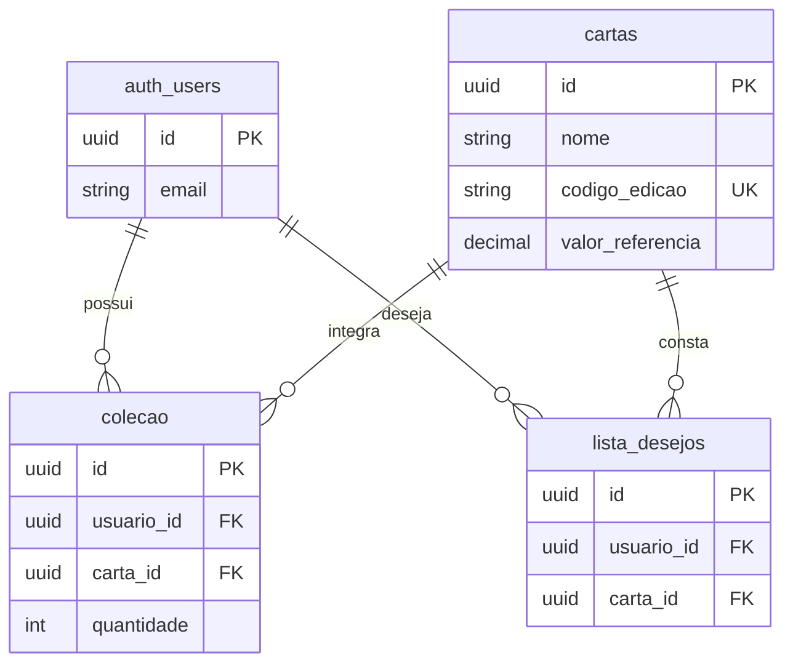

# CardDex — Plataforma inteligente para organização e acompanhamento de coleções de cartas Yu-Gi-Oh!

**Especificação inicial do sistema (Fase 1)**  
**Estudante:** Davi Lucas Souza do Amaral  
**Turma:** 3º A — Técnico em Informática  
**Disciplina:** Desenvolvimento de Sistemas — IFRO Campus Porto Velho Calama  
**Situação:** planejamento; nenhuma funcionalidade foi implementada ou testada.

## 1. Objetivo

O CardDex será uma plataforma web para jogadores e colecionadores de cartas Yu-Gi-Oh! consultarem informações sobre cartas e organizarem suas coleções em um só lugar. O sistema permitirá registrar cartas possuídas, consultar quantidades e manter uma lista de cartas desejadas, reduzindo a necessidade de planilhas e anotações separadas. Quando houver um valor de referência cadastrado para a edição da carta, ele será exibido como estimativa, e não como preço de mercado em tempo real.

## 2. Usuários

- **Visitante (sem login):** pode criar uma conta, entrar no sistema e pesquisar e consultar o catálogo público de cartas.
- **Usuário cadastrado (autenticado):** pode sair da conta, pesquisar cartas e consultar suas informações, adicionar cartas à própria coleção, consultar e alterar quantidades, remover cartas da coleção, adicionar e remover itens da lista de desejos e visualizar valores estimados disponíveis. Cada usuário só pode modificar seus próprios registros.

Não haverá painel de administrador na primeira versão. O catálogo inicial será inserido previamente no banco de dados pelo responsável pelo desenvolvimento; cadastrar novas cartas no catálogo não fará parte das telas do usuário.

## 3. Casos de uso principais

- **UC01 — Criar conta:** o visitante informa e-mail e senha válidos e solicita o cadastro.
- **UC02 — Entrar e sair:** o usuário acessa a conta com suas credenciais e pode encerrar a sessão.
- **UC03 — Pesquisar cartas:** visitante ou usuário cadastrado pesquisa por nome e visualiza resultados do catálogo.
- **UC04 — Consultar detalhes:** visitante ou usuário cadastrado abre uma carta e consulta nome, código/edição e, quando disponível, valor estimado de referência.
- **UC05 — Registrar carta na coleção:** o usuário autenticado escolhe uma carta e informa uma quantidade, salvando o registro no banco.
- **UC06 — Consultar e atualizar coleção:** o usuário autenticado visualiza sua coleção, ajusta as quantidades ou remove um item.
- **UC07 — Gerenciar lista de desejos:** o usuário autenticado adiciona uma carta à lista, consulta a lista e remove itens.
- **UC08 — Visualizar estimativa da coleção:** o usuário autenticado vê valores estimados por item e o total parcial calculado apenas com cartas que tenham valor de referência cadastrado.

## 4. Requisitos funcionais

- **RF01 (UC01):** o sistema deve permitir que um visitante crie uma conta informando e-mail único e senha, validando os campos e retornando confirmação ou erro de cadastro.
- **RF02 (UC02):** o sistema deve permitir login com e-mail e senha cadastrados, rejeitar credenciais inválidas e oferecer a opção de sair da sessão.
- **RF03 (UC03):** o sistema deve permitir a busca por parte do nome de uma carta existente no catálogo, exibindo resultados correspondentes ou uma mensagem quando não houver resultados.
- **RF04 (UC04):** o sistema deve exibir os detalhes de uma carta selecionada, incluindo nome, código da edição e valor estimado de referência, quando este estiver disponível.
- **RF05 (UC05):** o sistema deve permitir que um usuário autenticado adicione uma carta do catálogo à própria coleção informando uma quantidade inteira positiva; se a carta já estiver cadastrada em sua coleção, deve atualizar a quantidade existente em vez de duplicar o registro.
- **RF06 (UC06):** o sistema deve permitir que cada usuário autenticado consulte somente os itens da própria coleção, altere quantidades para números inteiros positivos e remova itens, mantendo as alterações após atualizar a página ou entrar novamente.
- **RF07 (UC07):** o sistema deve permitir que um usuário autenticado adicione cartas à própria lista de desejos, consulte essa lista e remova cartas, sem criar itens duplicados.
- **RF08 (UC08):** o sistema deve mostrar o valor de referência por carta, quando cadastrado, e calcular o total parcial da coleção pela soma de `quantidade × valor_referencia` das cartas com valor disponível; deve informar claramente quando houver cartas sem valor de referência, não tratando o total parcial como valor integral ou cotação atualizada.

## 5. Requisitos não funcionais

- **RNF01 — Proteção das senhas:** senhas nunca devem ser armazenadas em texto puro; o cadastro e o login devem utilizar o Supabase Auth, que realiza o tratamento seguro das credenciais com hash.
- **RNF02 — Validação no servidor:** todo formulário que cria ou altera dados deve ser validado também no servidor ou no serviço de autenticação/banco de dados, além de eventuais validações no navegador. E-mails precisam ter formato válido e quantidades devem ser números inteiros positivos.
- **RNF03 — Privacidade e acesso:** registros de coleção e lista de desejos devem ser associados ao usuário autenticado e protegidos por políticas de acesso do banco (Row Level Security — RLS), impedindo consulta ou alteração por outras contas.
- **RNF04 — Segurança das configurações:** segredos e credenciais de servidor devem ficar em variáveis de ambiente, nunca em arquivos públicos ou no repositório; todas as interações publicadas devem utilizar HTTPS.
- **RNF05 — Desempenho:** em testes com catálogo inicial de até 500 cartas e conexão estável, as páginas de consulta e coleção devem apresentar resultados em até 3 segundos na maioria das tentativas, sem contar o tempo do primeiro carregamento da hospedagem.
- **RNF06 — Usabilidade:** a interface deve ser legível no computador e no celular, ter menus simples e exibir mensagens claras após operações de cadastro, edição, remoção ou erro.
- **RNF07 — Integridade:** o banco deve utilizar chaves estrangeiras e restrições de unicidade para impedir registros de coleção/lista de desejos ligados a cartas inexistentes ou duplicados para um mesmo usuário.

## 6. Modelo de dados (DER simples)

O banco utilizará o **PostgreSQL do Supabase**. Os usuários serão gerenciados pela tabela de autenticação `auth.users` do próprio Supabase. O CardDex terá três tabelas próprias:

- **cartas:** `id` (UUID, PK), `nome` (TEXT, obrigatório), `codigo_edicao` (TEXT, obrigatório e único), `valor_referencia` (NUMERIC(10,2), opcional, maior ou igual a zero). Cada registro representa uma carta de uma edição específica. A primeira versão terá um catálogo inicial pequeno, inserido antes dos testes; não depende de API externa.
- **colecao:** `id` (UUID, PK), `usuario_id` (UUID, FK → `auth.users.id`, obrigatório), `carta_id` (UUID, FK → `cartas.id`, obrigatório), `quantidade` (INTEGER, obrigatória, maior que zero). Deve existir uma restrição `UNIQUE(usuario_id, carta_id)`.
- **lista_desejos:** `id` (UUID, PK), `usuario_id` (UUID, FK → `auth.users.id`, obrigatório), `carta_id` (UUID, FK → `cartas.id`, obrigatório). Deve existir uma restrição `UNIQUE(usuario_id, carta_id)`.

**Relacionamentos:** um usuário pode ter muitos itens na coleção e muitos na lista de desejos; uma carta pode aparecer na coleção e na lista de desejos de diferentes usuários. Cada registro de coleção ou desejo pertence a exatamente um usuário e uma carta. As tabelas `colecao` e `lista_desejos` estarão protegidas por RLS baseada no usuário autenticado. O catálogo `cartas` terá permissão pública apenas de leitura; sua atualização ocorrerá pelo responsável pelo projeto, fora da interface pública.

**Observação sobre o DER:** `auth_users` representa graficamente a tabela gerenciada `auth.users` do Supabase. Valores de referência serão preenchidos manualmente para fins de demonstração quando houver informação disponível; não representam avaliações atuais verificadas. Campos sem valor serão tratados como indisponíveis.

## 7. Critérios de aceite

- **CA01 / RF01:** Dado que o visitante informa um e-mail ainda não cadastrado e uma senha válida, quando envia o formulário de cadastro, então o sistema registra a conta no serviço de autenticação e apresenta o resultado do cadastro; se o e-mail já existir, não cria outra conta com o mesmo endereço.
- **CA02 / RF02:** Dado que existe uma conta válida, quando o usuário informa as credenciais corretas, então o sistema permite o acesso às áreas privadas; quando informa credenciais incorretas, então apresenta erro sem abrir a sessão; ao escolher sair, encerra a sessão.
- **CA03 / RF03:** Dado que o catálogo contém uma carta com o nome pesquisado, quando o visitante digita parte desse nome, então a carta aparece na lista de resultados; se não houver correspondência, aparece uma mensagem de lista vazia.
- **CA04 / RF04:** Dado que uma carta está no catálogo, quando alguém abre seus detalhes, então visualiza nome e código da edição e, se existir, seu valor de referência; sem valor cadastrado, aparece “Valor indisponível”.
- **CA05 / RF05:** Dado que o usuário está autenticado e escolheu uma carta, quando informa quantidade inteira maior que zero e confirma a inclusão, então a carta aparece na sua coleção com a quantidade gravada; se já existir, a quantidade do registro é atualizada sem duplicá-lo.
- **CA06 / RF06:** Dado que um usuário possui uma carta na coleção, quando abre a coleção e altera a quantidade ou remove o item, então a mudança é salva e permanece após recarregar a página; outra conta não consegue consultar nem alterar esses registros.
- **CA07 / RF07:** Dado que um usuário está autenticado e visualiza uma carta, quando a adiciona à lista de desejos, então ela aparece em sua lista sem duplicação; quando a remove, então deixa de aparecer após atualizar a página.
- **CA08 / RF08:** Dado que uma coleção possui duas unidades de uma carta com valor de referência de R$ 5,00 e uma carta sem referência, quando o usuário consulta o resumo, então o sistema exibe total parcial de R$ 10,00 e avisa que existe carta sem valor informado; não apresenta esse total como cotação atual do mercado.

## 8. Decisão de stack e deploy

- **Interface e lógica da aplicação:** Next.js com JavaScript, para construir as páginas do site e suas rotas de servidor dentro de um único projeto, com uso do Google Antigravity como ferramenta de apoio ao desenvolvimento.
- **Banco de dados:** PostgreSQL hospedado no Supabase, para armazenar o catálogo e as relações da coleção e da lista de desejos.
- **Autenticação:** Supabase Auth, integrado ao aplicativo, evitando a criação manual de um sistema de senhas; políticas RLS protegerão registros particulares no banco.
- **Versionamento:** Git e GitHub, com alterações revisadas e registradas em commits durante o desenvolvimento.
- **Publicação:** Vercel, conectada ao repositório GitHub, por ser compatível com Next.js. O Supabase continuará hospedando o banco e a autenticação separadamente.

**Justificativa:** essa combinação permite desenvolver e publicar o CardDex sem administrar um servidor próprio e pode utilizar planos gratuitos para um protótipo escolar, respeitando os limites dos serviços. O projeto deverá ser testado localmente, ter variáveis de ambiente configuradas na Vercel e ser publicado somente após conferir login, gravação e consulta de dados e políticas de acesso. O uso de IA não substitui a revisão humana do código e dos testes.

**Limite da primeira versão:** coleção, lista de desejos, pesquisa, autenticação e exibição de referências de valor previamente cadastradas. Reconhecimento de cartas por imagem, consulta automática de preços, histórico de variações, notificações e expansão para outros jogos são possibilidades futuras e não fazem parte dos requisitos obrigatórios desta entrega.
